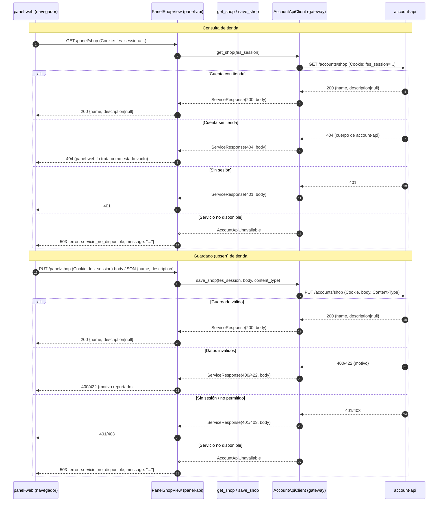
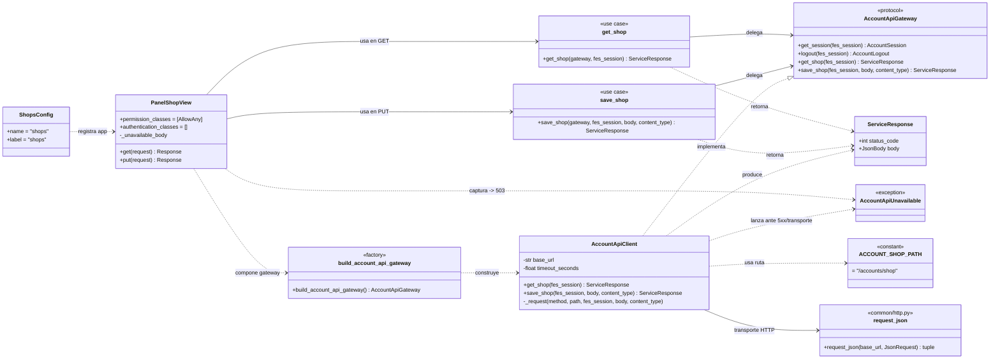

# UML 003 — Frontera de gestión de tienda del vendedor

Este documento describe el desarrollo de `panel-api` para la spec 003: una frontera que reenvía
la consulta y el guardado de la tienda del vendedor hacia `account-api`, sin modelo ni
migración local. La identidad y la tienda son propiedad de `account-api`; `panel-api` solo
transporta la cookie de sesión `fes_session` y retransmite estado y cuerpo JSON.

## Flujo principal (secuencia)

El navegador (`panel-web`) llama a `panel-api` con la cookie `fes_session`. `panel-api` construye
el gateway con `build_account_api_gateway()`, y la vista `PanelShopView` invoca el caso de uso
correspondiente (`get_shop` o `save_shop`), que delega en `AccountApiGateway`. El adaptador
`AccountApiClient` hace la llamada HTTP real a `account-api` reenviando la cookie mediante el
header `Cookie`. Los `200`/`404`/`401`/`403`/`400`/`422` se retransmiten tal cual; cualquier
error de transporte o `5xx` se convierte en `AccountApiUnavailable` y la vista responde `503`
con el cuerpo de contrato, sin borrar la cookie.

Observaciones de contrato:

- La sesión nunca se invalida en `panel-api`; la cookie solo se reenvía. Un `503` no emite
  `Set-Cookie` de borrado (RF-12).
- `PUT` es upsert en `account-api`: crea si no existe y reemplaza `name`/`description` si
  existe (RF-3, RF-4).
- `panel-api` no valida ni transforma `name`/`description`; solo reenvía bytes (RF-13).

## Estructura de componentes

La vista depende de los casos de uso; los casos de uso dependen del port `AccountApiGateway`;
el adaptador `AccountApiClient` implementa el port y usa el transporte compartido `request_json`
de `common/http.py`. `build_account_api_gateway()` es el punto de composición que construye el
cliente desde settings. La app `shops` no tiene `models.py` ni `migrations/`.

## Notas de ubicación y dependencias

- `src/shops/api/views/panel_shop.py`: vista DRF delgada; traduce HTTP a entrada de casos de
  uso y arma la respuesta. No contiene reglas de negocio ni acceso HTTP saliente directo.
- `src/shops/use_cases/get_shop.py` y `save_shop.py`: orquestación mínima, sin Django ni DRF.
- `src/common/ports/account_api_gateway.py`: contrato de la frontera con `account-api`.
- `src/common/infrastructure/clients/account_api_client.py`: adaptador concreto; reenvía la
  cookie `fes_session` y mapea fallos a `AccountApiUnavailable`.
- `src/common/contracts/account_api.py`: `ACCOUNT_SHOP_PATH = "/accounts/shop"`.
- `src/config/settings.py` y `src/config/urls.py`: registro de la app `shops` y ruta
  `panel/shop`.
- Sin `src/shops/models.py` ni `src/shops/migrations/`: `panel-api` no persiste tienda
  (RF-7, RF-8).
